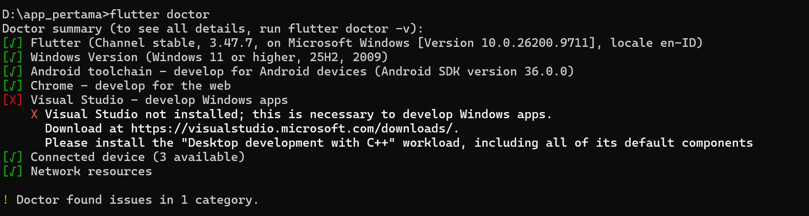
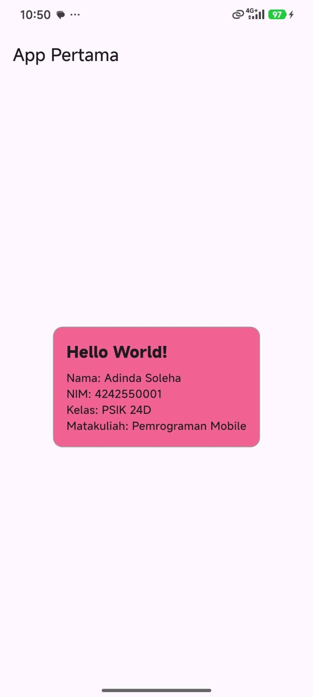

# Pemrograman Mobile - Tugas Rutin 1

Aplikasi Flutter sederhana yang menampilkan Hello World beserta biodata.

## Identitas
- Nama  : Adinda Soleha
- NIM   : 4242550001
- Kelas : PSIK 2024 D
- Matakuliah: Pemrograman Mobile

## Versi Flutter
Hasil perintah `flutter --version`:

Flutter 3.47.7 • channel stable • https://github.com/flutter/flutter.git
Framework • revision abaf9c5237 (2 weeks ago) • 2026-10-08 09:51:21 -0700
Engine • hash d8a2d6c768c334d53e16277f837970ffa1e2de81 (revision deb287481e) (16 days ago) • 2026-10-07 17:09:12.000Z
Tools • Dart 3.13.5 • DevTools 2.60.0

## Tangkapan Layar

**flutter doctor**

**Tampilan aplikasi (di HP)**

## Widget yang Digunakan
`MaterialApp`, `Scaffold`, `Center`, `Column`, `Text`, serta widget tambahan `Icon` dan `SizedBox`.

## Kendala dan Solusi

1. **Salah paham arti "widget"**
   - Kendala: Awalnya mengira tugas membuat App Widget Android (widget di home screen), sehingga mencari file konfigurasi `AppWidgetProviderInfo` yang ternyata tidak relevan untuk Flutter.
   - Solusi: Menyadari bahwa di Flutter "widget" adalah komponen UI, lalu membuat tampilan lewat `lib/main.dart`.

2. **Aplikasi tidak jalan di Chrome lewat VS Code**
   - Kendala: Aplikasi tidak berjalan saat hanya menekan tombol Run.
   - Solusi: Menjalankan lewat **Start Debugging (F5)** sehingga aplikasi berhasil dibuka dan hot reload berfungsi.

## Pernyataan Penggunaan AI
Saya menggunakan Claude sebagai alat bantu untuk memahami struktur kode Flutter (StatelessWidget, StatefulWidget, dan widget dasar), contoh kode awal, serta troubleshooting Git dan VS Code. Kode telah saya jalankan, uji, dan sesuaikan sendiri.